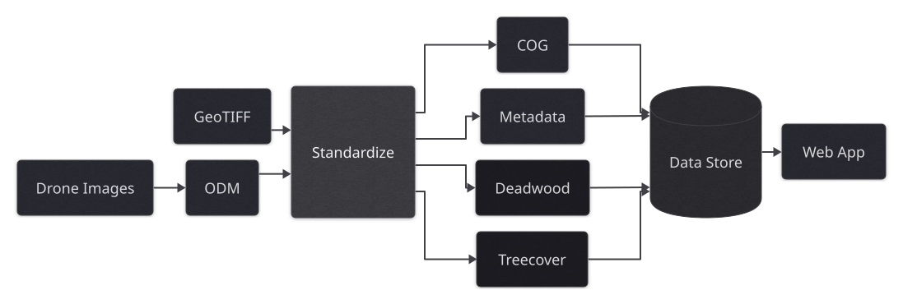

# ForestWatch – Geospatial Forest Monitoring and AI-based Analysis

[](https://www.python.org/)
[](LICENSE)
[]()
[]()

> A personal adaptation of the open-source DeadTrees platform, extended for geospatial forest monitoring, raster/vector analysis, and AI-assisted environmental assessment.

**Original project:** [DeadTrees – Deadwood AI](https://github.com/Deadwood-ai/deadtrees)

**Original authors:** DeadTrees Team

**Maintainer of this adaptation:** [Your Name / GitHub Username]

---

## 1. Overview

ForestWatch is a Python-oriented geospatial monitoring project built upon the open-source DeadTrees platform.

The project explores the use of geospatial data engineering, remote sensing, raster and vector processing, and deep learning for forest monitoring and environmental analysis.

The upstream DeadTrees platform provides an existing foundation for processing high-resolution aerial imagery, generating Cloud-Optimized GeoTIFFs (COGs), enriching geospatial metadata, and performing deep-learning-based deadwood and tree-cover segmentation.

This adaptation aims to extend that foundation with additional geospatial analysis capabilities and reproducible deployment workflows.

The broader objective is to develop a modular geospatial processing environment that can support forest-cover assessment, spatial analysis, and potentially multi-temporal deforestation monitoring.

## 2. Project Objectives

The project is organized around the following technical areas:

- **Geospatial databases:** PostgreSQL and PostGIS for spatial data management and querying.
- **Raster analysis:** Processing GeoTIFF imagery, vegetation indices, and geospatial raster datasets.
- **Vector analysis:** Spatial operations, geometry processing, and geospatial data integration.
- **GeoAI:** Deep-learning-based image segmentation and land-cover analysis.
- **Forest monitoring:** Tree-cover assessment and development of multi-temporal forest-change analysis.
- **Reproducible infrastructure:** Docker-based development and deployment, automated testing, and CI/CD.

## 3. Existing Platform Capabilities

The following capabilities originate from the upstream DeadTrees project:

### Data ingestion
- GeoTIFF orthomosaic uploads.
- Raw drone imagery ingestion through ZIP archives.
- OpenDroneMap-based orthomosaic generation.
- Chunked file upload and dataset metadata management.

### Raster processing
- GeoTIFF standardization.
- Cloud-Optimized GeoTIFF generation.
- Thumbnail generation.
- Geospatial metadata enrichment.

### Geospatial enrichment
- GADM administrative boundaries.
- WWF terrestrial ecoregions.
- MODIS vegetation phenology information.

### Deep learning
- SegFormer-based deadwood segmentation.
- Tree-cover detection using a SegFormer-based model.
- Polygon-based segmentation outputs.

### Data management and visualization
- FastAPI backend.
- PostgreSQL-backed metadata and geometry storage.
- React and OpenLayers frontend.
- Interactive visualization and review of segmentation results.

## 4. My Contributions

This section documents functionality independently implemented or modified in this repository.

**Only include features that you have actually implemented and tested.**

| Area | My implementation |
|---|---|
| Geospatial database | [Describe your PostGIS integration, if implemented] |
| Raster processing | [Describe additional Rasterio/GDAL workflows] |
| Vector analysis | [Describe spatial queries and geometry operations] |
| GeoAI | [Describe your model changes or inference workflows] |
| Forest monitoring | [Describe your forest-cover or deforestation analysis] |
| Docker | [Describe your deployment improvements] |
| CI/CD | [Describe your GitHub Actions workflows and tests] |

## 5. Additional Geospatial Development

The following are potential extension areas, depending on implementation status:

### Raster analysis
- GeoTIFF processing using Rasterio and GDAL.
- Coordinate reference system transformations.
- Vegetation-index calculations.
- Raster clipping, reprojection, and mosaicking.

### Vector analysis
- Vector data processing using GeoPandas and Shapely.
- Spatial joins and intersection analysis.
- Geometry validation and spatial indexing.
- Conversion of raster classifications into vector geometries.

### PostGIS integration
- Spatial database schema development.
- Geometry storage and indexing.
- Spatial queries using PostGIS.
- Integration between Python geospatial workflows and PostgreSQL.

### Forest change analysis
- Multi-temporal satellite imagery processing.
- Vegetation-index comparison.
- Tree-cover change detection.
- Development of a deforestation assessment workflow.

*These are development objectives, not claims that all functionality is already available.*

## 6. Technology Stack

| Component | Technologies |
|---|---|
| Main language | Python |
| Backend | FastAPI |
| Raster processing | Rasterio, GDAL |
| Vector processing | GeoPandas, Shapely |
| Spatial database | PostgreSQL, PostGIS (where enabled) |
| Deep learning | PyTorch, SegFormer |
| Cloud raster format | Cloud-Optimized GeoTIFF |
| Drone processing | OpenDroneMap |
| Frontend | React, TypeScript, OpenLayers |
| Infrastructure | Docker, Docker Compose |
| Testing | pytest |
| CI/CD | GitHub Actions (where configured) |

## 7. System Architecture

The inherited processing architecture supports ingestion of aerial orthomosaics and drone imagery, raster standardization, metadata enrichment, and deep-learning segmentation.

Additional modules developed in this repository can be integrated into the processing pipeline as independent geospatial processing stages.



*Architecture diagram originating from the upstream DeadTrees project.*

## 8. Repository Structure

The current repository structure is inherited from the upstream project. Directory names should be updated if the implementation changes.

```text
forestwatch/
├── api/                # FastAPI backend
├── processor/          # Geospatial processing and ML jobs
├── shared/             # Shared Python modules
├── supabase/           # Database schema and migrations
├── frontend/           # React and OpenLayers application
├── deadtrees-cli/      # Development CLI
├── docs/               # Technical documentation
├── .github/            # GitHub Actions workflows
├── docker-compose.api.yaml
├── docker-compose.processor.yaml
├── pyproject.toml
└── README.md
```

## 9. Local Development

For initial setup, consult the upstream development documentation:

[DeadTrees Development Setup](https://github.com/Deadwood-ai/deadtrees/blob/main/docs/dev-setup.md)

Replace the upstream clone URL with your repository URL when cloning your adaptation.

The environment requires Python, Node.js, Docker, and the relevant processing dependencies. GPU support may be required for some machine-learning workloads.

Document the operating system, dependency versions, and setup commands that you have personally verified.

## 10. Testing and Quality Assurance

Testing and automation are documented according to the workflows actually enabled in this repository.

Potential validation areas include:

- Python unit and integration tests.
- Raster and vector processing validation.
- Database migration and spatial-query tests.
- API endpoint testing.
- Docker build validation.
- Automated CI checks through GitHub Actions.

## 11. Future Development

Potential future improvements include:

- Sentinel-2 satellite imagery processing.
- Multi-temporal NDVI analysis.
- Automated forest-cover change detection.
- PostGIS spatial analysis and indexing.
- Integration of additional GeoAI models.
- Automated geospatial quality assessment.
- Improved Docker deployment and CI/CD automation.

## 12. Acknowledgements

This repository builds upon the work of the DeadTrees Team.

Original repository: https://github.com/Deadwood-ai/deadtrees

The upstream project provides the original geospatial ingestion, deadwood detection, tree-cover segmentation, and platform infrastructure.

The original authors and their copyright notices are retained in accordance with the MIT License.

## 13. License

This project retains the original MIT-licensed DeadTrees code and its associated copyright and license notices.

See the [LICENSE](LICENSE) file for the applicable license terms.

Additional datasets, model weights, and third-party components may have separate licensing conditions.